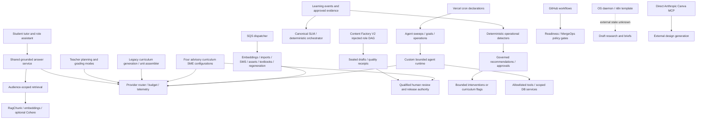

# Project Atlas agent and workflow dependency map

Edges summarize inspected call paths. They do not assert deployment or that every imported optional dependency executes. Detailed known imports are cached in CANDIDATES.json; graph coverage is bounded by source inspection.

## Duplication decisions

| Responsibility | Members | Decision |
| --- | --- | --- |
| operational health | ops-sentinel; autonomous runtime-health/dead-letter-inspection; check-dlq | INTEGRATE observations and owner/alert registry; retain domain-specific detectors |
| draft research/brief generation | os-vault-daemon; n8n-daily-pulse; docs/internal research-agent | Share context contracts and usage ledger; persona is not another deployed agent |
| content review | content-qa; curriculum aiReview SMEs; Content Factory evaluators; qa-governance persona | Different stages need one rubric/version contract and human authority, not indiscriminate deletion |
| developer review | .claude review personas; OS audit workflow; GitHub CI/Lab gates | Personas interpret evidence; deterministic CI gates remain executable authority |
| Teacher planning | lib/teacher/lessonPlanner.ts; lib/ai/teacher/lessonPlanner.ts | Both invoked by same route for different task shapes; consolidate governance/types while keeping weekly vs single-lesson task modes. |
| Advisory grading | lib/teacher/gradingAssist.ts; lib/workflows/ai/gradingAssist.ts; lib/ai/homeworkGrader.ts; lib/ai/homework-grader.ts; lib/ai/rubric-generator.ts | Separate use cases and persistent schemas, overlapping prompt/moderation/score authority; migrate caller contracts before retiring any implementation. |
| Tutor | lib/ai/tutor/studentTutor.ts; lib/ai/rag/groundedAnswerService.ts | Already adapter + shared implementation; retain adapter or migrate carefully, do not report as duplicate engine. |
| Mastery/read models | lib/learning-state/studentLearningModel.ts; lib/adaptive/updateMastery.ts; lib/student/learningIntelligence.ts | Canonical event-replayed state, legacy strand EMA, heuristic reporting coexist; make provenance explicit and prevent dashboard percentages becoming canonical authority. |

The primary reuse decisions are to keep one provider router, one grounded-answer engine with role-specific adapters, one authoritative learner-state path, existing review/release authority, and the deterministic factory manager. `lib/ai/router.ts` is already a re-export; it is not a competing router. Textbook compilation is deterministic. ContentFactory V2 role names do not prove eight autonomous model agents. See ROOT-001, ROOT-016, ROOT-034 and LEARN source references in [inventory](AGENT_INVENTORY.md).

There are multiple real planning and grading implementations and several content-authoring entry points. Consolidate shared contracts, moderation, usage accounting and provenance before retiring callers; retain separate weekly/single-lesson and advisory/official workflows. Do not delete historical score or curriculum readers to tidy names. Compare legacy-curriculum-generation, content-factory-v2, elite-upgrade, unit-assembler and exam-generation in the canonical registry.

## Reachability, cycles and broken connections

Only goal-echo has a registered goal handler. The schedule/event registration APIs have no production registrations found by the reviewer; this is a bounded source-search finding, not proof no external host can register at runtime. The eight-role factory has an explicit acyclic dependency graph and attempts bounded1-5. The generic agent runtime is bounded by depth/time and JSON repair; no verified unbounded autonomous call cycle was established. Whole-program dynamic cycle freedom is unverified. Evidence: [factory graph](../../../lib/content-factory/v2/manager.ts#L6), [automation findings](automation-review.md).

The SQS worker deliberately rejects known unimplemented audio/autonomous job variants and retries/DLQs them. Recovery enqueue success must not be reported as successful execution. Cron Bearer-contract mismatches, optional budget context and unenforced generic tool role/output declarations are concrete integration gaps. See AT-R-WORKER, AUTO-R1, AT-R-COST and SEC-R05 in [risk register](RISK_REGISTER.md).

Ops Sentinel, runtime-health, DLQ checks, heartbeat and incident dashboards overlap operational ownership. Integrate their health registry and alert delivery while keeping deterministic domain detectors. OS research briefs, n8n and research personas need one canonical context and cost ledger; repository docs alone cannot prove redundancy of hosted workflows. No distinct LangChain/LangGraph or executable REA agent was located in targeted source/history searches. REA remains an unresolved alias, not a fabricated catalog entry.

## Simplified target

Versioned source/ontology → existing factory and author adapters → sealed draft → qualified review → exact released composition → ScheduledWork → assistance-aware attempts → verified learner evidence → canonical SLM → deterministic recommendation → teacher action → measured reassessment. Shared provider/cost/moderation services support these stages; LLM outputs never supply their own approval authority. This reuses the accepted ContentBundle convergence direction in [readiness decision](../../../docs/architecture/content-factory/CONTENT_FACTORY_READINESS_V1.md#L18).
